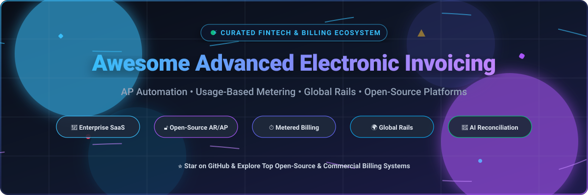

  

# 🧾 Awesome Advanced Electronic Invoicing 🚀

  
  
  
  
  
  
  

---

## 🌟 Overview & Highlights

A curated directory of leading **SaaS platforms** and **open-source GitHub projects** dedicated to **Advanced Electronic Invoicing (e-Invoicing)**, **Accounts Payable (AP) Automation**, **Accounts Receivable (AR) Billing**, **Usage-Based Metering**, and **Global B2B Payment Rails**.

Whether you are evaluating enterprise financial engines or self-hosting open-source invoicing infrastructure with full compliance (PEPPOL, CTC, clearance models), this guide provides clear, data-backed breakdowns.

---

## 📑 Table of Contents

- [📈 Sector Overview & Market Dynamics](#-sector-overview--market-dynamics)
- [🏢 SaaS/Hosted Platforms](#-saashosted-platforms)
- [🔓 Open-Source GitHub Projects](#-open-source-github-projects)
- [🤝 How to Contribute](#-how-to-contribute)
- [☕ Support](#-support)
- [📊 Star History](#-star-history)
- [⚠️ Disclaimer](#️-disclaimer)

---

## 📈 Sector Overview & Market Dynamics

The global electronic invoicing (e-invoicing) market is valued at approximately **$11 billion to $18+ billion in 2026** and is projected to expand at an accelerating **CAGR of 16%–19%** through the 2030s, driven worldwide by mandatory government tax clearance models (PEPPOL, CTC, VAT digitization) and cross-border B2B digital commerce.

From a competitive landscape perspective, the market is **moderately fragmented** rather than a winner-take-all monopoly: diverse regional tax compliance mandates and local banking rails empower agile, region-specific players to thrive, while multi-billion-dollar enterprise platforms (such as Stripe, Tipalti, and Bill.com) capture dominant market share among multinational mid-market and enterprise organizations.

---

## 🏢 SaaS/Hosted Platforms

The table below provides transparency across category leaders, sorted by **company scale (descending)**, including verified starting pricing tiers and free tier / trial terms.

| 🏷️ Product | 📊 Company Scale (Valuation / Revenue / Market Cap) | 💳 Starting Tier Pricing | 🎁 Free Tier / Trial Limits | 🔍 Category & Key Details |
| :--- | :--- | :--- | :--- | :--- |
| **Stripe Invoicing** | **$159B Valuation** (Private tender) / ~$14B+ Rev | Starter: **0.4% per paid invoice** (or Plus: 0.5% per paid invoice) | **Free forever plan**: $0/mo fixed fees with 25 free invoices per month; fees apply only when invoices are paid through Stripe | **AR Invoicing**: Auto-reconciliation, Smart Retries, hosted client portals, and quote workflows. |
| **Tipalti** | **$8.3B Valuation** (Private Series F) / ~$150M+ ARR | Select tier starting at **$99/month** (transaction fees per payment/invoice apply) | **No free tier or public free trial**; evaluation requires a scheduled sales demo or private developer sandbox | **AP Automation**: Global mass payouts across 200+ countries with AI OCR bill capture and supplier tax onboarding. |
| **Bill.com** | **~$4.4B Market Cap** (NYSE: BILL) / ~$1.3B Annual Rev | Essentials/Team tier starting at **$45–$65/user/month** (plus ACH/check per-transaction fees) | **30-day free trial** with full feature access (bills, invoices, sync workflows, up to standard transaction limits) | **AP/AR Automation**: Domestic US payment rails, multi-stage approval routing, and 2-way ERP sync. |
| **Chargebee** | **$3.5B Valuation** (Private Series H) / ~$200M+ ARR | Flow PAYG starting at **$0/month + 0.80% of monthly invoicing** (or Starter/Base at $99/month + 0.65% with 100M events/mo) | **Unlimited free sandbox environment** (no card required, test catalogs & simulated payments); startup plan free up to $1M cumulative billings | **Subscription & Usage**: Recurring billing, hybrid metered usage, credits, and revenue recognition. |
| **HighRadius** | **$3.1B Valuation** (Private Series C) / ~$300M+ ARR | **$0 implementation & $0 subscription fees until go-live**; post-launch pricing tied to gain-share % on agreed KPI improvements (or custom annual licensing starting ~$50K/year) | **No free tier or public self-serve trial**; requires private sales consultation and enterprise guided demo | **Autonomous Finance**: AI order-to-cash, predictive collections, deductions, and cash application. |
| **Flywire (Invoiced)** | **~$2.5B Market Cap** (Parent: FLYW, acquired Invoiced for $55M) / ~$700M+ Rev | Custom quote-based packages starting historically around **$100–$500/month** plus per-transaction processing | **No public free tier or automated trial**; custom enterprise sandbox environment provided upon sales request | **B2B AR Automation**: Global payment collections, customer portal, dispute management, and multi-currency rails. |
| **AvidXchange** | **~$2.1B Valuation** (Acquisition / Taken Private) / ~$400M+ Rev | Custom quote tiers with estimated entry starting around **$440–$500/month** ($5,000–$6,000/year plus transaction fees around $6.50–$7.50/tx) | **No free tier or self-serve trial**; customized walkthrough and demo environment only through sales | **Mid-Market AP Automation**: Supplier network matching, automated purchase orders, and payment execution. |
| **Zuora** | **$1.7B Buyout Valuation** (Acquired by Silver Lake / GIC) / ~$450M+ Rev | Enterprise custom quote-only pricing (starting license typically ~$1,000+/month or customized annual contracts) | **No free tier or open trial**; Developer/API sandbox available for partners and enterprise testing limited to 5,000 records & 10,000 calls/day | **Enterprise Monetization**: Complex subscription quoting, dynamic pricing models, and ASC 606 revenue compliance. |
| **Quadient AP** | **~$1.2B Enterprise Value** / ~€500M ($540M) Market Cap (Euronext: QDT) / ~€1.04B ($1.1B) Rev | Small-business tier starting at **$2,000/year** (~$166/month) scaling up to $10,000+/year based on invoice volume | **No free tier or self-serve trial**; product evaluation only via customized live sales demos and webinars | **Modular AP Automation**: Beanworks engine for automated multi-entity invoice capture, PO matching, and approvals. |
| **Maxio** | **~$150M+ Growth Equity Backing** (Battery Ventures; Chargify + SaaSOptics) / ~$50M+ ARR | Grow tier starting at **$599/month** (covers up to $100K/month in billing volume) | **Build developer plan ($0 free sandbox)** with full API & mock gateway access; plus **30-day evaluation trial** upon qualification | **SaaS Finance Engine**: Advanced billing, self-service customer portal, CPQ, and SaaS metrics analytics. |

---

## 🔓 Open-Source GitHub Projects

Explore the premier open-source and self-hosted invoicing, billing APIs, and accounting projects. Sorted strictly by **GitHub Stargazers (descending)**.

| 📦 Repository & Project | ⭐ GitHub Stars | 💻 Tech Stack | 📜 License | 🎯 Highlights & Capabilities |
| :--- | :--- | :--- | :--- | :--- |
| **[Midday](https://github.com/midday-ai/midday)** |  | TypeScript, Next.js, Tailwind, Supabase | MIT License | Invoicing, automated bank reconciliation, financial overview, storage, and AI assistant built for modern businesses and freelancers. |
| **[Lago](https://github.com/getlago/lago)** |  | Ruby on Rails, Go, React, PostgreSQL | AGPL-3.0 | Open-source metering and usage-based billing API engine. Consumption tracking, complex subscription management, and payment orchestration. |
| **[Invoice Ninja](https://github.com/invoiceninja/invoiceninja)** |  | PHP (Laravel), Flutter, MySQL | Elastic License 2.0 | The most mature self-hosted invoicing suite. Client portal, quotes, automated recurring invoices, expense tracking, and 30+ payment gateways. |
| **[Akaunting](https://github.com/akaunting/akaunting)** |  | PHP (Laravel), Vue.js, MySQL | GPL-3.0 | Complete open-source accounting and electronic invoicing web software designed for small businesses and independent contractors. |
| **[IDURAR ERP CRM](https://github.com/idurar/idurar-erp-crm)** |  | Node.js, Express, React, Redux, MongoDB | MIT License | Free open-source ERP, CRM, and modern accounting application with integrated invoicing, payment tracking, and inventory control. |
| **[Ever Gauzy](https://github.com/ever-co/ever-gauzy)** |  | TypeScript, NestJS, Angular, TypeORM | Apache-2.0 | Enterprise business management platform featuring invoicing, estimates, expense management, project billing, and HR operations. |
| **[Crater](https://github.com/crater-invoice-inc/crater)** |  | PHP (Laravel), Vue.js, React Native | Open Source | Clean, self-hosted web and mobile invoicing application made for freelancers and small businesses to track payments and issue professional invoices. |
| **[Kill Bill](https://github.com/killbill/killbill)** |  | Java, OSGi, PostgreSQL / MySQL | Apache-2.0 | Open-source enterprise billing and payment engine capable of handling complex subscription logic, invoice generation, and custom payment gateways. |
| **[InvoicePlane](https://github.com/InvoicePlane/InvoicePlane)** |  | PHP (CodeIgniter), MySQL | Open Source | Focused, lightweight self-hosted application for managing client lists, quotes, invoices, tax calculations, and basic payment receipts. |
| **[OpenMeter](https://github.com/openmeterio/openmeter)** |  | Go, Kafka, ClickHouse | Apache-2.0 | High-scale real-time metering engine built for AI, APIs, and developer platforms to collect millions of usage events for usage-based billing. |

---

## 🤝 How to Contribute

Contributions are warmly encouraged! To propose a new SaaS solution or open-source repository:

1. 🍴 **Fork** the repository.
2. 🌿 Create a descriptive feature branch (`git checkout -b feature/add-new-invoicing-tool`).
3. 📝 Update `README.md` keeping the sorted ranking format intact. Include:
   - Tool name & official repository / website link
   - Verified pricing or license details
   - Accurate company scale or GitHub star badge
4. 🚀 Push your branch and open a **Pull Request** with a brief summary of the addition.

---

## ☕ Support

If you find this curated directory helpful for your team, financial architecture, or open-source stack:

- ⭐ **Star this repository** to help others discover it!
- 🍴 **Fork and share** with fellow developers and finance engineers.
- 💖 **Sponsor or buy a coffee**: Support ongoing curation and maintenance via the [GitHub Sponsor Dashboard](https://github.com/sponsors/ishandutta2007).

---

## 📊 Star History

---

## ⚠️ Disclaimer

- This repository is a **community-curated index** created solely for informational and educational purposes — not an official financial or legal endorsement.
- Invoicing systems handling sensitive transaction and customer data must strictly comply with regional data privacy laws (GDPR, CCPA) and government e-invoicing compliance mandates (e.g. PEPPOL, Italy SDI, France Factur-X, India e-Invoice QR).
- **AP vs. AR vs. Subscription vs. Outcome-based**:
  - **AR Invoicing** (*Stripe Invoicing, Invoice Ninja, InvoicePlane, Crater*): Emits customer bills and collects inbound customer revenue.
  - **AP Automation** (*Tipalti, Bill.com, AvidXchange, Quadient AP*): Digitizes supplier invoices, performs PO matching, and automates outbound vendor disbursements.
  - **Subscription & Usage Metering** (*Chargebee, Zuora, Maxio, Lago, OpenMeter*): Calculates recurring and event-based usage fees.
  - **Outcome-Based** (*HighRadius*): Ties platform investment to verified measurable working capital gains.
- Verify security, encryption standards, and hosting compliance before deploying self-hosted financial software in live production environments.

---

  <b>Built with ❤️ for finance engineers, AP/AR managers, and teams architecting modern billing platforms.</b>

